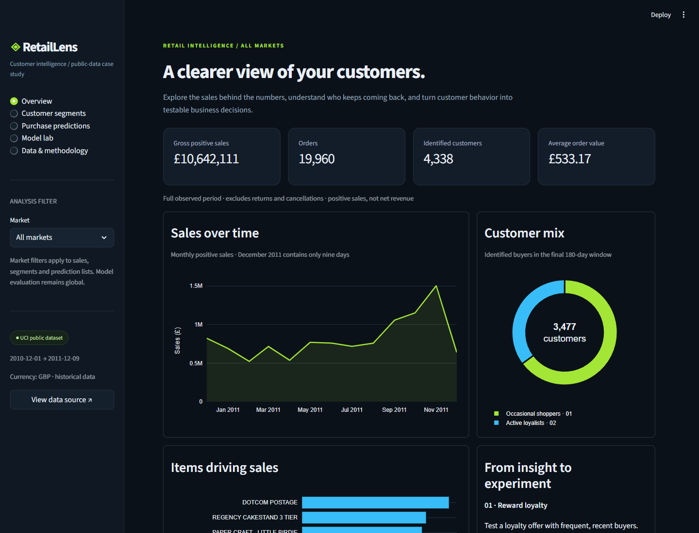
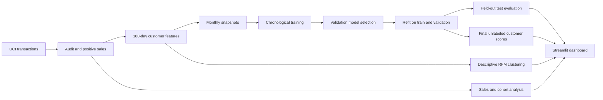

# RetailLens

**Customer segmentation and repeat-purchase prediction from real retail transactions.**

A reproducible data science case study that connects transaction quality, customer behavior,
chronological machine learning evaluation and an interactive decision dashboard.
Built with Python, pandas, scikit-learn, Plotly and Streamlit.



## Business questions

- How do sales and customer activity change over time?
- Which behavioral customer groups emerge from recency, frequency and spend?
- Which existing customers are likely to buy again in the next 30 days?
- What experiments could test whether loyalty or reactivation offers help?

This is an independent historical case study, not a live retailer product or proof of campaign uplift.

## What is included

| Component | Deliverable |
| --- | --- |
| Data ingestion | Public UCI download with SHA-256 provenance and optional local input |
| Quality audit | Reconciled cleaning counts, missing customer IDs and explicit revenue definition |
| Exploratory analysis | Monthly sales, product performance and observed-cohort retention |
| Customer segmentation | Standardized log-RFM K-means; k=2…6 compared by sampled silhouette |
| Prediction | Prior baseline, logistic regression and histogram gradient boosting |
| Evaluation | Chronological train / validation / test; average precision, ROC AUC, Brier and top-decile lift |
| Dashboard | Market filtering, segment profiles, customer ranking, CSV export and model evidence |
| Reproducibility | Analytical notebook, automated tests, GitHub Actions and generated findings |

## Quick start

Use **Python 3.12 or newer**. Commands are shown for PowerShell on Windows:

```powershell
python -m venv .venv
.\.venv\Scripts\python.exe -m pip install -r requirements-dev.txt
.\.venv\Scripts\python.exe -m retaillens.pipeline
.\.venv\Scripts\python.exe -m streamlit run app.py
```

On macOS / Linux, replace `.\.venv\Scripts\python.exe` with `.venv/bin/python`.
Open the local URL printed by Streamlit, normally **http://localhost:8501**.
The first pipeline run downloads the source; later runs reuse the local XLSX.
For the verified library versions, install `requirements-lock.txt` instead of `requirements-dev.txt`
(add `pytest` and `nbformat` if running tests or the notebook verification script).

To use an already downloaded copy:

```powershell
.\.venv\Scripts\python.exe -m retaillens.pipeline --input 'data/raw/Online Retail.xlsx'
```

Compatible CSV input is supported with the same eight source columns. Custom datasets need at least
three complete monthly snapshots after a 180-day lookback, both classes per split, and enough customer variation for clustering.

## Results

| Model | Validation average precision | Test average precision | Test ROC AUC |
| --- | ---: | ---: | ---: |
| Prior baseline | 0.309 | 0.384 | 0.500 |
| Logistic regression | 0.555 | 0.654 | 0.718 |
| Gradient boosting (selected) | **0.560** | **0.659** | **0.720** |

The selected model's top-decile test precision is **84.4%**, compared with **38.4%**
test prevalence (**2.20× lift**). Lift measures ranking concentration, not campaign uplift.
The test snapshot is **1 November 2011**, with purchases observed for the following 30 days.

Actual results from the full source dataset are documented in [the findings report](reports/findings.md)
and [machine-readable evaluation](reports/evaluation.json). Each dashboard metric is calculated from the cleaned data.
Raw files, customer-level exports and model binaries are intentionally regenerated rather than committed.
Aggregate reports remain available in GitHub without running the pipeline.

## Prediction design



Features are computed from **[cutoff − 180 days, cutoff)**. The binary label is any positive purchase
in **[cutoff, cutoff + 30 days)**. Incomplete future windows are rejected. Training labels must mature
before the validation decision time, and validation labels must mature before the test time.

Monthly snapshots may contain the same customer across periods. This evaluates prediction for
**existing customers**, not generalization to unseen customer identities. Customer IDs are not model features.
All supervised preprocessing is fitted on training data. Model selection uses validation average precision;
the held-out test is used for final comparison and diagnostic importance only.

After selection, candidates are refitted on train + validation for a like-for-like test comparison.
The selected model scores the final snapshot without treating its unavailable future labels as known outcomes.
Probability estimates are not separately calibrated. Ranking customers by purchase likelihood does not identify
who will respond incrementally to a campaign.

## Data definitions and limitations

- **Sales:** positive quantity × positive unit price; excludes cancellation invoices, returns and non-positive values.
  It is gross positive sales in GBP, **not net revenue or profit**.
- **Orders:** distinct invoice numbers; average order value is sales divided by orders.
- Sales without customer IDs remain in sales analysis but are excluded from segmentation and prediction.
- Exact-row deduplication is a documented heuristic and may remove legitimate repeated transaction lines.
- Clusters use the final 180-day window. Names describe medians; they are not validated marketing personas.
- Customer country is the latest eligible purchase country. Country filters do not refit models or clusters.
- Tenure is measured from the first purchase **within the lookback window**, not true lifetime tenure.
- Cohorts use first **observed** purchases. Unobserved cohort months remain blank; observed non-return months are zero.
- One UK retailer in 2010–2011, including wholesale shoppers, cannot establish current industry behavior.
- December 2011 is partial. Product codes may include service charges and non-merchandise items.
- Proposed campaigns require experiments before claiming improved retention or revenue.

## Explore and verify

Open [the analysis notebook](notebooks/retail_analysis.ipynb) in a Jupyter or VS Code kernel containing the project dependencies.
Run from the repository root or the `notebooks` folder. It reads pipeline outputs and demonstrates the analytical steps.

```powershell
.\.venv\Scripts\python.exe -m pytest -q
```

Tests cover cleaning reconciliation, anonymous sales, cutoff and label boundaries,
future-feature leakage, incomplete label windows and temporal label overlap.
GitHub Actions runs these tests without downloading the full source dataset.
Desktop and mobile browser checks are documented in [validation](docs/validation.md).
After generating the dataset artifacts, optional smoke checks are available:

```powershell
.\.venv\Scripts\python.exe scripts/verify_notebook.py
.\.venv\Scripts\python.exe scripts/verify_dashboard.py
```

The notebook verifier executes ordinary Python code cells in the current interpreter and saves
their text/rich outputs; it does not require a separate Jupyter runner. It regenerates notebook outputs.

## Repository layout

```text
app.py                        Interactive dashboard
retaillens/pipeline.py        Download → audit → segment → evaluate → export
notebooks/retail_analysis.ipynb
tests/test_pipeline.py        Critical analytical correctness tests
reports/                      Executed results and quality audit
artifacts/dashboard/          Generated dashboard data and aggregate metadata
artifacts/models/             Local model binaries, ignored by Git
data/raw/                     Local source download, ignored by Git
docs/                         Dashboard screenshots and verification notes
```

## Source and attribution

Chen, D. (2015). **Online Retail** [Dataset]. UCI Machine Learning Repository.
[https://doi.org/10.24432/C5BW33](https://doi.org/10.24432/C5BW33).
[Dataset page](https://archive.ics.uci.edu/dataset/352/online+retail).
541,909 original transaction lines, covering 1 December 2010 through 9 December 2011.
Dataset license: [Creative Commons Attribution 4.0](https://creativecommons.org/licenses/by/4.0/).

Original code and documentation: [MIT](LICENSE). No paid API, credentials, scraping or field observation is required.
